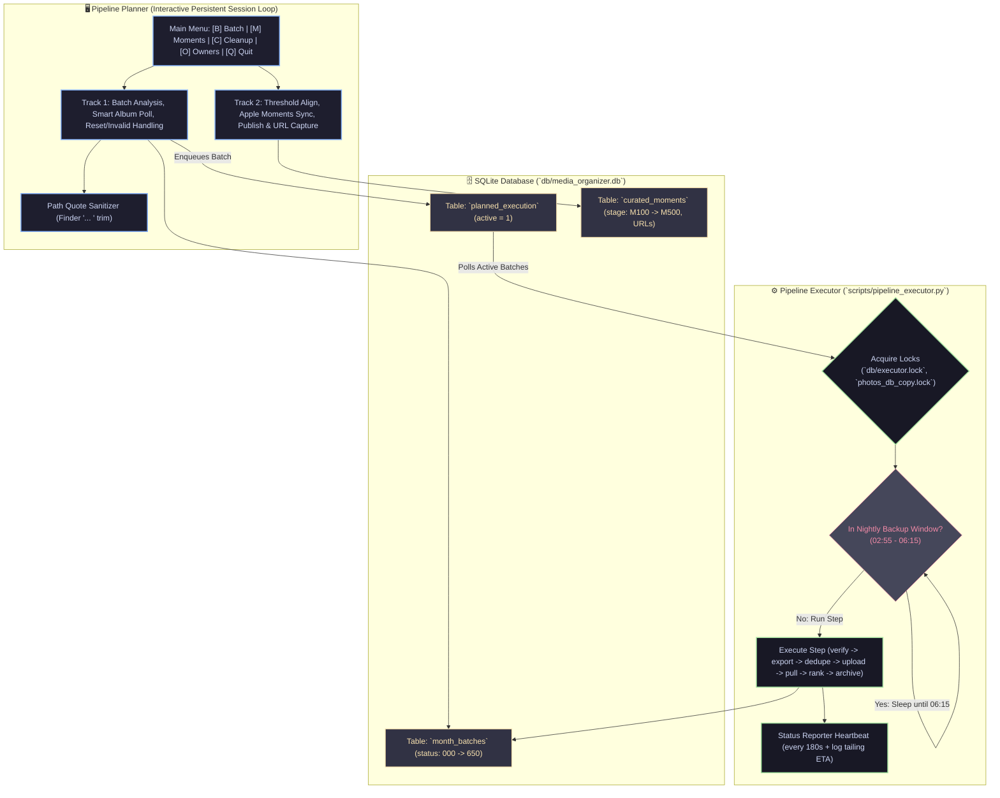
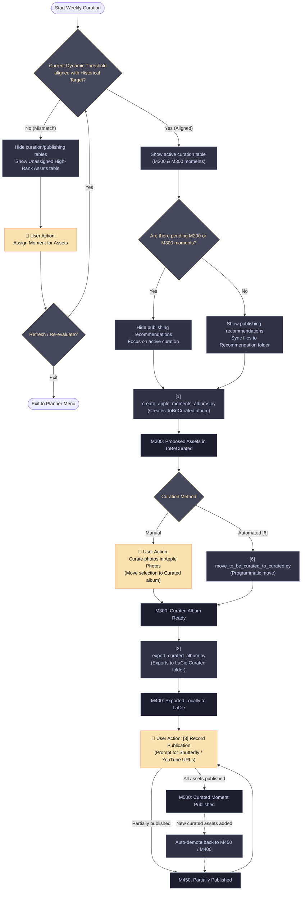

# 📋 Media Organizer Pipeline Architecture

This document provides the definitive architectural specification, flowcharts, and operational patterns for the **Media Organizer Pipeline**. It covers both **Track 1 (Monthly Ingest & Cloud Archive Lifecycle)** and **Track 2 (Weekly Moments Curation & Publishing)**, along with system-level orchestration and background execution.

---

## 🏛️ System-Level Orchestration & Architecture

The pipeline uses a **decoupled, event-driven architecture**: an interactive central planner ([`scripts/pipeline_planner.py`](file:///Users/nickolaycohen/dev/media-organizer-pipeline/scripts/pipeline_planner.py)) plans and stages batches into an execution queue, and an autonomous background worker ([`scripts/pipeline_executor.py`](file:///Users/nickolaycohen/dev/media-organizer-pipeline/scripts/pipeline_executor.py)) processes the queued steps sequentially with database locking and safety window awareness.

---

## 🚀 Track 1: Batch Management (Monthly Ingest & Cloud Archive Lifecycle)

Track 1 ingests photos month-by-month from Apple Photos, exports them to LaCie staging, dedupes them, uploads them to Google Photos, captures Google AI curation/favorites, ranks assets, and retains them permanently in the cloud archive.

```mermaid
flowchart TD
    classDef state fill:#1e1e2e,stroke:#cdd6f4,stroke-width:1px,color:#cdd6f4;
    classDef action fill:#313244,stroke:#a6adc8,stroke-width:1px,color:#cdd6f4;
    classDef decision fill:#45475a,stroke:#f9e2af,stroke-width:1px,color:#f9e2af;
    classDef prompt fill:#f9e2af,stroke:#fab387,stroke-width:1.5px,color:#11111b;
    
    Start([Start Batch]) --> T1_000["000: Initialized in DB"]:::state
    T1_000 --> Dec_SmartAlbum{"Smart Album exists in Apple Photos?<br/>(Polled by Planner)"}:::decision
    
    Dec_SmartAlbum -- "No" --> Prompt_CreateAlbum["👤 User Action:<br/>Create Smart Album in Apple Photos<br/>(Planner polls every 3s)"]:::prompt
    Prompt_CreateAlbum --> Dec_SmartAlbum
    Dec_SmartAlbum -- "Yes" --> Act_Verify["verify_export_album.py"]:::action
    
    Act_Verify --> T1_100["100: Assets Verified in DB"]:::state
    T1_100 --> Act_Export["export_photos_wrapper.py<br/>(Direct disk read from originals/)"]:::action
    Act_Export --> T1_200["200: Exported to Staging"]:::state
    
    T1_200 --> Act_Dedupe["deduplicate_assets.py"]:::action
    Act_Dedupe --> T1_210["210: Deduplicated & Ready"]:::state
    
    T1_210 --> Dec_Seq{"Sequencing & Continuity OK?"}:::decision
    Dec_Seq -- "Continuity Gap" --> Prompt_Seq["👤 User Prompt:<br/>Ignore continuity gaps?"]:::prompt
    Prompt_Seq -- "Yes" --> Act_Upload["upload_to_google_photos.py"]:::action
    Prompt_Seq -- "No" --> Abort([Abort/Skip Batch])
    Dec_Seq -- "OK" --> Act_Upload
    
    Act_Upload --> Dec_Quota{"Did all files fit?"}:::decision
    Dec_Quota -- "No (Partial)" --> T1_399["399: Partial Upload"]:::state
    Dec_Quota -- "Yes (Full)" --> T1_400["400: Upload Completed"]:::state
    T1_399 --> Act_Upload
    
    T1_400 --> Prompt_Curation["👤 User Prompt:<br/>Google Photos Curation complete?<br/>(Enforces 3-day wait if 0 favs)"]:::prompt
    Prompt_Curation -- "Yes (y)" --> T1_500["500: Curation Done"]:::state
    Prompt_Curation -- "Bypass" --> T1_500_Bypass["500: Direct-Rank Bypassed<br/>(is_bypassed=1)"]:::state
    Prompt_Curation -- "No (N)" --> T1_400
    
    T1_500 --> Act_Pull["pull_google_favorites.py"]:::action
    T1_500_Bypass --> Act_Pull
    
    Act_Pull --> T1_550["550: Google Favorites Pulled"]:::state
    T1_550 --> Act_Rank["rank_assets_by_score.py"]:::action
    Act_Rank --> T1_600["600: Assets Ranked & Scored"]:::state
    
    T1_600 --> Dec_LateAssets{"Late assets detected after >=600?"}:::decision
    Dec_LateAssets -- "Reset requested" --> Reset_Flow["Option A: Reset to 100/210<br/>Option B: Reset to 000"]:::action
    Reset_Flow --> T1_100
    Dec_LateAssets -- "Suppress" --> Mark_Invalid["Mark late imports as INVALID &<br/>set ignore_continuity_check=1"]:::action
    Mark_Invalid --> Act_Cleanup
    Dec_LateAssets -- "None" --> Act_Cleanup["delete_google_assets.py<br/>(Cloud Archive Mode)"]:::action
    
    Act_Cleanup --> T1_650["650: Cloud Retained in Google Photos<br/>& Local Staging Cleaned Up"]:::state
```

### Track 1 Stage Reference Table (`batch_status`)

| Code | Short Label | Full Description | Stage | Script Invoked | Transition Type |
| :--- | :--- | :--- | :--- | :--- | :--- |
| **000** | `added` | Batch initialized and added to DB | 1.2 | `generate_month_batches.py` | `pipeline` |
| **100** | `assets_verified` | Batch assets verified in Media Organizer DB | 2.1 | `verify_export_album.py {month}` | `pipeline` |
| **100E**| `verify_failed` | Batch asset verification failed | 2.1 | `verify_export_album.py {month}` | `pipeline` |
| **200** | `exported` | Batch assets exported directly to staging | 2.2 | `export_photos_wrapper.py {month}` | `pipeline` |
| **200E**| `export_failed` | Direct export to staging failed | 2.2 | `export_photos_wrapper.py {month}` | `pipeline` |
| **210** | `deduplicate_assets` | Remove duplicate assets based on extension and size | 2.2.5 | `deduplicate_assets.py {month}` | `pipeline` |
| **399** | `uploading_to_google`| Upload to Google Account from Staging Folder (Partial) | 2.4 | `upload_to_google_photos.py {month}` | `pipeline` |
| **400** | `uploaded_to_google` | Upload to Google Account from Staging Folder (Full) | 2.4 | `upload_to_google_photos.py {month}` | `retryable` |
| **400E**| `Upload Error` | Upload to Google Photos failed | 2.4 | `upload_to_google_photos.py {month}` | `pipeline` |
| **500** | `Google Photos Curation` | Google AI creating Memories & Best of album | 3.1 | *(Manual human confirmation or bypass)* | `manual` |
| **550** | `pull_google_favorites` | Pull Google Photos Favorites and update asset flags | 3.2 | `pull_google_favorites.py` | `pipeline` |
| **600** | `ranked` | Assets ranked and exported for human review | 3.4 | `rank_assets_by_score.py {month}` | `pipeline` |
| **650** | `cloud_retained` | Batch completed with cloud archive retention and local staging cleanup | 4.2 | `delete_google_assets.py {month}` | `pipeline` |

---

## 🎨 Track 2: Memory Feature & Publishing (Weekly Moments Workflow)

Track 2 operates independently of the batch ingester. It selects the highest-quality ranked/scored assets from Track 1, suggests event-based moments, syncs them to Apple Photos for curation, and tracks publications across Shutterfly and YouTube.

### Track 2 Memory Stages (`curated_moments.memory_stage`)

| Stage | Description | Trigger / Condition |
| :--- | :--- | :--- |
| **M100** | Candidate Moment Identified | Moment has qualified assets above the dynamic threshold, but has not yet been synced to Apple Photos. |
| **M200** | Sync Proposed to Apple Photos | Assets synced into `ToBeCurated > <MomentName>` smart/regular albums in Apple Photos via Action `[1]`. |
| **M300** | Manual Curation Completed | Curated selection placed into `Curated > <MomentName>` album (manually or via Action `[6]`). |
| **M400** | Curated Folder Exported | Assets exported from Apple Photos to local LaCie folder via Action `[2]`. |
| **M450** | Partially Published | A subset of the moment's assets have been recorded as published in `publications` via Action `[3]`. |
| **M500** | Fully Published | All curated assets for the moment are published. URLs are stored in `curated_moments` and `publications`. |

---

## 🧠 Core Design Patterns & Behaviors

### 1. Cloud Archive Mode (5TB Google Tier) vs Local Staging Cleanup
Under the 5TB storage tier, the pipeline **permanently retains all uploaded assets in Google Photos** to preserve cloud search, Google AI indexing, and mobile access. 
* **Stage 650** ([`scripts/delete_google_assets.py`](file:///Users/nickolaycohen/dev/media-organizer-pipeline/scripts/delete_google_assets.py)) operates by default in **Cloud Archive Mode**.
* It purges residual local scratch files in LaCie's staging directory (`clean_staging`) while keeping the cloud library intact.
* Legacy manual deletion (`--manual-delete`) remains available as a fallback flag only.

### 2. Direct-Rank Bypass & Retroactive Favorites Sync
When Google Photos AI has not generated a "Best of Month" album after the 3-day maturation window, the user can enter `bypass` at the Step 500 prompt:
* Sets `is_bypassed = 1` and records `bypass_timestamp` in `month_batches`.
* Allows immediate transition to `550` and `600` so aesthetic ranking can proceed without blocking the pipeline.
* Enforces a **14-day grace period** before stage 650 cleanup to allow backend indexing.
* **Retroactive Sync**: At every planner session startup, the system queries the Google Photos API for favorites across bypassed months. If late favorites arrive, it updates `google_favorite = 1` **specifically for assets belonging to created/curated moments**, automatically recalculating the normalized score in `ranked_assets_view`.

### 3. Late-Asset Detection & Reset Handling
When photos are imported with timestamps matching a previously finalized batch ($\ge 600$), [`pipeline_planner.py`](file:///Users/nickolaycohen/dev/media-organizer-pipeline/scripts/pipeline_planner.py) flags the batch:
* **Option A (Full Reset)**: Resets batch status to `100` (or `210`), clears asset flags (`uploaded_to_google = 0`, `google_favorite = 0`), and enqueues a fresh re-export and re-upload.
* **Option B (Batch Re-init)**: Resets `status_code = '000'` for a full lifecycle rerun.
* **Suppress / Ignore**: Marks late assets with `ignore_continuity_check = 1` and marks their import batches in `imports` as `status_code = 'INVALID'` so the prompt is permanently suppressed.

### 4. Publication URL Tracking
When recording publications via Action `[3]` or editing via Action `[7]`:
* Photos default to **Shutterfly** (`nickolay.cohen@gmail.com`).
* Videos default to **YouTube** (`nickolay.cohen@gmail.com`).
* URLs are stored in `curated_moments.shutterfly_url`, `curated_moments.youtube_url`, and `publications.published_url`.
* Existing URLs are presented as defaults when recording incremental publications.

### 5. Concurrency Locks & Nightly Backup Window
* **Locks**: `db/executor.lock` (PID-based) and `db/photos_db_copy.lock.json` prevent concurrent database writes between planner, executor, and background sync services.
* **Backup Window**: [`constants.is_in_backup_window()`](file:///Users/nickolaycohen/dev/media-organizer-pipeline/constants.py) automatically pauses both executor and planner between **02:55 and 06:15 AM** to allow Carbon Copy Cloner and automated database backups to run without lock contention.

### 6. Device Ownership, Family Membership & Quartile Media Cleanup
The pipeline maintains a structured registry of camera devices and owners to govern media intake, attribution, and on-device storage cleanup:
* **Family Membership Flag (`owners.is_family`)**:
  Distinguishes immediate household members (`is_family = 1`: e.g., Benny, Niki, Cohens, Roberto, Eva) whose physical devices are actively maintained, from external contributors, relatives, or friends (`is_family = 0`: e.g., Ani Ivanova, Bianca, Lee, Nickolay Vassilev, Tedi i Vessi) whose imported media is cataloged for attribution only.
* **Active Device Tracking (`device_owners.is_active` & `end_date`)**:
  A device is active if `is_active = 1` and `(end_date IS NULL OR end_date >= date('now'))`. Retired devices (`is_active = 0` or past `end_date`) remain in the registry to map historical ownership periods and explain handoffs.
* **Quartile Media Cleanup Filtering**:
  Mode `[C]` partitions assets into 4 quality quartiles based on normalized aesthetic scores (Q1 & Q2 representing the bottom 50% lowest quality). To keep cleanup recommendations actionable:
  - **Default View (`🟢 Active Family Devices Only`)**: Filters exclusively to currently active devices belonging to family members (`is_family = 1` and `is_active = 1`). External friends' cameras and retired 10-to-20-year-old devices are hidden.
  - **Historical Toggle (`[T]`)**: Users can toggle between Active Family Devices and All Historical Devices to inspect retired hardware if needed.
  - **Intake Blacklist Protection**: When an asset is marked as removed from source (`removed_from_source = 1`), [`scripts/triage_media_intake.py`](file:///Users/nickolaycohen/dev/media-organizer-pipeline/scripts/triage_media_intake.py) blacklists it permanently, preventing future phone syncs or backup dumps from re-importing discarded assets.
